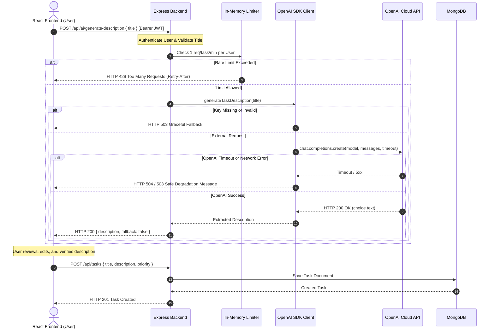

# Practical 13: AI API Integration into a Web Application

**Course:** Advanced Web Development Frameworks (AWDF)  
**Student ID:** D25DIT096  
**Topic:** Integrating External AI APIs (OpenAI) into a Full-Stack MERN Application  

---

## 1. Introduction & Theoretical Background

### 1.1 Architecture of External AI API Integration
Modern web applications frequently enrich user workflows by interfacing with generative Artificial Intelligence (AI) foundation models through cloud REST APIs or official Software Development Kits (SDKs). In full-stack architectures (such as React + Express + MongoDB), AI capabilities should **never** be called directly from the client application. Instead, all AI interactions must follow a **secure backend proxy pattern**:



### 1.2 Core Integration Principles
1. **Confidentiality of Secrets:** Client applications (browsers) execute in an untrusted environment where network traffic and bundled assets can be decompiled. Private API keys (e.g., `OPENAI_API_KEY`) must strictly reside on the Node.js backend.
2. **Graceful Degradation:** The primary task management system must never crash or block core CRUD workflows if third-party AI APIs become unreachable, rate-limited, or misconfigured.
3. **Controlled Scope & Cost Protection:** Request timeouts (`AI_TIMEOUT_MS`), model selection (`OPENAI_MODEL`), max token limits, and per-user per-task rate limiting prevent unexpected latency spikes and runaway billing costs.
4. **Responsible AI by Design:** Users retain final editorial agency. Suggestions are presented in an editable text area accompanied by a disclaimer that AI output must be reviewed before saving.

---

## 2. Updated Project Structure

```text
Practical-13/
├── .github/
│   └── workflows/
│       └── ci.yml                     # GitHub Actions CI pipeline with mock-safe test suite
├── backend/
│   ├── config/
│   │   ├── cache.js                   # NodeCache configuration
│   │   └── db.js                      # MongoDB connection handler
│   ├── controllers/
│   │   ├── aiController.js            # [NEW] Validates title, handles fallback, returns description
│   │   ├── authController.js          # User registration & JWT authentication
│   │   └── taskController.js          # Task CRUD with caching and events
│   ├── events/
│   │   ├── taskEvents.js              # EventEmitter instance
│   │   └── taskListeners.js           # Async background notification listener
│   ├── middleware/
│   │   ├── aiRateLimit.js             # [NEW] 1 request / task / minute per authenticated user
│   │   ├── authMiddleware.js          # JWT Bearer verification
│   │   ├── errorMiddleware.js         # Centralized HTTP error handler
│   │   └── validationMiddleware.js    # express-validator rules for tasks
│   ├── models/
│   │   ├── Task.js                    # Mongoose Task schema
│   │   └── User.js                    # Mongoose User schema
│   ├── routes/
│   │   ├── aiRoutes.js                # [NEW] POST /generate-description & GET /status
│   │   ├── authRoutes.js              # /register, /login, /me
│   │   ├── debugRoutes.js             # Cache inspect/clear endpoints
│   │   └── taskRoutes.js              # Task CRUD routes
│   ├── services/
│   │   └── aiService.js               # [NEW] Reusable OpenAI client with timeout & error mapping
│   ├── tests/
│   │   ├── ai.test.js                 # [NEW] 13 automated tests for Tests A through F
│   │   └── app.test.js                # CI integration tests
│   ├── .dockerignore
│   ├── .env                           # Local environment secrets (excluded from Git)
│   ├── .env.example                   # Safe template with placeholder values
│   ├── .gitignore
│   ├── app.js                         # Express application definition & route mounting
│   ├── Dockerfile                     # Multi-stage production container
│   ├── package.json                   # Dependencies (includes 'openai')
│   └── server.js                      # Server listener entry point
├── frontend/
│   ├── src/
│   │   ├── api/
│   │   │   └── api.js                 # [UPDATED] Adds generateTaskDescription() API method
│   │   ├── components/
│   │   │   ├── Navbar.jsx
│   │   │   ├── ProtectedRoute.jsx
│   │   │   ├── TaskForm.jsx           # [UPDATED] "Generate description with AI" button, loading state & disclaimer
│   │   │   ├── TaskItem.jsx
│   │   │   ├── TaskList.jsx
│   │   │   └── Toast.jsx
│   │   ├── context/
│   │   │   └── AuthContext.jsx
│   │   ├── pages/
│   │   │   ├── Login.jsx
│   │   │   ├── Register.jsx
│   │   │   └── TaskDashboard.jsx
│   │   ├── App.jsx
│   │   └── index.css                  # Modern dark glassmorphic styling & animations
│   ├── .dockerignore
│   ├── .env
│   ├── .env.example
│   ├── .gitignore
│   ├── Dockerfile
│   ├── nginx.conf
│   └── package.json
├── .env                               # Root environment configuration
├── .env.example                       # Root environment template
├── .gitignore
├── docker-compose.yml                 # Multi-container orchestration (MongoDB + Backend + Frontend)
├── postman_collection.json            # Complete Postman test collection (Tests A - F)
└── README.md                          # Comprehensive documentation & Lab Journal
```

---

## 3. Implementation Details

### 3.1 Step 1: Secure Environment Configuration
The OpenAI API key is stored exclusively in `backend/.env` and injected into the Node.js runtime using `dotenv`.

`backend/.env`:
```env
PORT=5000
MONGO_URI=mongodb://127.0.0.1:27017/task_management
JWT_SECRET=pr11_super_secret_jwt_key_98234729384729384_container_2026
JWT_EXPIRES_IN=1h
CLIENT_URL=http://localhost:5173
CACHE_TTL=60
ENABLE_CACHE=true
NOTIFICATION_DELAY_MS=2000

# OpenAI API Configuration
OPENAI_API_KEY=your_actual_api_key
OPENAI_MODEL=gpt-4o-mini
AI_TIMEOUT_MS=15000
```

`backend/.env.example`:
```env
PORT=5000
MONGO_URI=mongodb://127.0.0.1:27017/task_management
JWT_SECRET=your_jwt_secret_key_here
JWT_EXPIRES_IN=1h
CLIENT_URL=http://localhost:5173
CACHE_TTL=60
ENABLE_CACHE=true
NOTIFICATION_DELAY_MS=2000

# OpenAI API Configuration
OPENAI_API_KEY=your_openai_api_key_here
OPENAI_MODEL=gpt-4o-mini
AI_TIMEOUT_MS=15000
```

Both `.gitignore` files contain `.env` and `.env.local` to prevent accidental credential leakage into version control.

---

### 3.2 Step 2: Reusable OpenAI Service (`backend/services/aiService.js`)
Initializes the official OpenAI client as a singleton, manages request timeouts, and translates raw provider exceptions into standardized application errors:

```javascript
const OpenAI = require('openai');

const getApiKey = () => process.env.OPENAI_API_KEY || '';
const getModel = () => process.env.OPENAI_MODEL || 'gpt-4o-mini';
const getTimeout = () => Number(process.env.AI_TIMEOUT_MS) || 15000;

let clientInstance = null;

const isConfigured = () => {
    const key = getApiKey().trim();
    if (!key) return false;
    if (key === 'your_actual_api_key' || key === 'your_openai_api_key_here' || key === 'your_api_key_here') {
        return false;
    }
    return true;
};

const getClient = () => {
    if (!clientInstance) {
        clientInstance = new OpenAI({
            apiKey: getApiKey(),
            timeout: getTimeout(),
            maxRetries: 1
        });
    }
    return clientInstance;
};

const resetClient = () => { clientInstance = null; };
const setClient = (mockClient) => { clientInstance = mockClient; };

const generateTaskDescription = async (title) => {
    if (!isConfigured()) {
        const error = new Error('OpenAI API key is not configured or contains placeholder values.');
        error.code = 'AI_NOT_CONFIGURED';
        error.status = 503;
        throw error;
    }

    const client = getClient();
    const model = getModel();

    const systemPrompt = 
        'Write a clear, concise task description based on the supplied task title. ' +
        'Describe the intended work and expected outcome. ' +
        'Do not invent deadlines, personal information, or unsupported requirements. ' +
        'Return only the description.';

    try {
        const completion = await client.chat.completions.create({
            model,
            messages: [
                { role: 'system', content: systemPrompt },
                { role: 'user', content: title }
            ],
            max_tokens: 150,
            temperature: 0.7
        });

        const choice = completion.choices && completion.choices[0];
        const content = choice && choice.message && choice.message.content 
            ? choice.message.content.trim() 
            : '';

        if (!content) {
            const error = new Error('AI provider returned an empty or malformed completion.');
            error.code = 'EMPTY_RESPONSE';
            error.status = 502;
            throw error;
        }

        return {
            description: content,
            fallback: false,
            message: 'AI description generated successfully.'
        };
    } catch (error) {
        if (error.code === 'AI_NOT_CONFIGURED' || error.code === 'EMPTY_RESPONSE') {
            throw error;
        }

        const classifiedError = new Error(error.message || 'AI service failure');
        if (error instanceof OpenAI.AuthenticationError || error.status === 401) {
            classifiedError.message = 'AI authentication failed. Invalid API credentials.';
            classifiedError.code = 'AUTHENTICATION_ERROR';
            classifiedError.status = 503;
        } else if (error instanceof OpenAI.RateLimitError || error.status === 429) {
            classifiedError.message = 'AI provider rate limit reached. Please try again shortly.';
            classifiedError.code = 'PROVIDER_RATE_LIMIT';
            classifiedError.status = 503;
        } else if (error instanceof OpenAI.APIConnectionTimeoutError || error.name === 'APIConnectionTimeoutError') {
            classifiedError.message = 'AI request timed out.';
            classifiedError.code = 'TIMEOUT';
            classifiedError.status = 504;
        } else if (error instanceof OpenAI.APIConnectionError || error.code === 'ECONNREFUSED' || error.code === 'ENOTFOUND') {
            classifiedError.message = 'Unable to connect to AI provider network.';
            classifiedError.code = 'NETWORK_ERROR';
            classifiedError.status = 502;
        } else {
            classifiedError.message = 'AI service encountered an unexpected error.';
            classifiedError.code = 'PROVIDER_ERROR';
            classifiedError.status = 503;
        }

        throw classifiedError;
    }
};

module.exports = {
    getClient,
    setClient,
    resetClient,
    isConfigured,
    generateTaskDescription
};
```

---

### 3.3 Step 3 & 4: AI Controller & Graceful Degradation (`backend/controllers/aiController.js`)
Validates incoming payload constraints, manages error classification, and returns fallback responses:

```javascript
const aiService = require('../services/aiService');

const generateDescription = async (req, res) => {
    try {
        const { title } = req.body || {};

        if (typeof title !== 'string' || !title.trim()) {
            return res.status(400).json({
                success: false,
                fallback: false,
                message: 'Task title is required and must be a non-empty string.'
            });
        }

        const trimmedTitle = title.trim();
        if (trimmedTitle.length > 200) {
            return res.status(400).json({
                success: false,
                fallback: false,
                message: 'Task title is too long (maximum 200 characters).'
            });
        }

        const result = await aiService.generateTaskDescription(trimmedTitle);

        return res.status(200).json({
            description: result.description,
            fallback: false,
            message: result.message || 'AI description generated successfully.'
        });
    } catch (error) {
        const errorCode = error.code || 'UNKNOWN_ERROR';
        console.warn(`[AI Controller Graceful Degradation] Code: ${errorCode} | Reason: ${error.message}`);

        const httpStatus = error.status || 503;

        return res.status(httpStatus).json({
            description: '',
            fallback: true,
            message: 'AI suggestions are temporarily unavailable. Please enter your description manually.'
        });
    }
};

const getAiStatus = (req, res) => {
    const configured = aiService.isConfigured();
    res.status(200).json({
        service: 'OpenAI Task Generator',
        configured,
        model: process.env.OPENAI_MODEL || 'gpt-4o-mini',
        timeoutMs: Number(process.env.AI_TIMEOUT_MS) || 15000,
        rateLimit: '1 request / task / minute'
    });
};

module.exports = {
    generateDescription,
    getAiStatus
};
```

---

### 3.4 Step 5: Rate Limiting Middleware (`backend/middleware/aiRateLimit.js`)
Restricts generation to **1 request per task title per authenticated user per 60 seconds**:

```javascript
const requestHistory = new Map();
const WINDOW_MS = 60 * 1000;

const pruneExpiredEntries = (now) => {
    if (requestHistory.size > 50) {
        for (const [key, timestamp] of requestHistory.entries()) {
            if (now - timestamp > WINDOW_MS) {
                requestHistory.delete(key);
            }
        }
    }
};

const aiRateLimit = (req, res, next) => {
    const userId = req.user && req.user.id ? req.user.id : req.ip;
    const rawTitle = req.body && req.body.title ? String(req.body.title) : '';
    const normalizedTitle = rawTitle.trim().toLowerCase();

    if (!normalizedTitle) {
        return next();
    }

    const now = Date.now();
    pruneExpiredEntries(now);

    const rateKey = `${userId}:${normalizedTitle}`;
    const lastRequestTime = requestHistory.get(rateKey);

    if (lastRequestTime && (now - lastRequestTime) < WINDOW_MS) {
        const remainingMs = WINDOW_MS - (now - lastRequestTime);
        const retryAfterSeconds = Math.ceil(remainingMs / 1000);

        res.set('Retry-After', String(retryAfterSeconds));
        return res.status(429).json({
            success: false,
            fallback: false,
            message: `Rate limit exceeded. Please wait ${retryAfterSeconds} second${retryAfterSeconds === 1 ? '' : 's'} before generating another description for this task.`,
            retryAfter: retryAfterSeconds
        });
    }

    requestHistory.set(rateKey, now);
    next();
};

const resetRateLimits = () => { requestHistory.clear(); };

module.exports = {
    aiRateLimit,
    resetRateLimits,
    WINDOW_MS
};
```

---

### 3.5 Step 6 & 7: React Frontend Form (`frontend/src/components/TaskForm.jsx`)
Features:
- Dedicated **"Generate description with AI"** button with a gradient sparkle aesthetic and loading spinner.
- Client-side pre-validation: disabled if the task title is empty.
- Editable textarea populated directly with the AI suggestion.
- Non-blocking error banner on service degradation or rate limiting.
- Clear **Responsible AI Disclaimer** prominently displayed below the field.

```jsx
import React, { useState, useEffect } from 'react';
import { PlusCircle, Save, X, Sparkles, Loader2, AlertCircle, Info } from 'lucide-react';
import { generateTaskDescription } from '../api/api';

const TaskForm = ({ onSubmit, isSubmitting, editTask, onCancelEdit }) => {
    const [task, setTask] = useState({
        title: '',
        description: '',
        priority: 'medium',
        completed: false
    });

    const [error, setError] = useState('');
    const [aiLoading, setAiLoading] = useState(false);
    const [aiError, setAiError] = useState('');
    const [hasAiGenerated, setHasAiGenerated] = useState(false);

    useEffect(() => {
        if (editTask) {
            setTask(editTask);
            setHasAiGenerated(false);
            setAiError('');
        }
    }, [editTask]);

    const handleChange = (e) => {
        const { name, value, type, checked } = e.target;
        setTask(prev => ({
            ...prev,
            [name]: type === 'checkbox' ? checked : value
        }));
        if (error) setError('');
    };

    const handleGenerateAiDescription = async () => {
        const currentTitle = task.title ? task.title.trim() : '';
        if (!currentTitle) {
            setError('Please enter a task title first to generate an AI description.');
            return;
        }

        setAiLoading(true);
        setAiError('');
        setError('');

        try {
            const data = await generateTaskDescription(currentTitle);
            if (data && data.description) {
                setTask(prev => ({ ...prev, description: data.description }));
                setHasAiGenerated(true);
            } else if (data && data.fallback) {
                setAiError(data.message || 'AI suggestions are temporarily unavailable. Please enter your description manually.');
            }
        } catch (err) {
            console.warn('[AI Generation Failure]', err.message);
            setAiError(err.message || 'AI suggestions are temporarily unavailable. Please enter your description manually.');
        } finally {
            setAiLoading(false);
        }
    };

    const handleSubmit = (e) => {
        e.preventDefault();
        if (!task.title.trim()) {
            setError('Title is required.');
            return;
        }
        onSubmit(task);
        if (!editTask) {
            setTask({ title: '', description: '', priority: 'medium', completed: false });
            setHasAiGenerated(false);
            setAiError('');
        }
    };

    return (
        <form onSubmit={handleSubmit} className="card" style={{ marginBottom: '2rem' }}>
            <div className="flex-between" style={{ marginBottom: '1rem' }}>
                <h3 style={{ margin: 0 }}>{editTask ? 'Edit Task' : 'Add New Task'}</h3>
                {editTask && (
                    <button type="button" className="btn btn-outline" onClick={onCancelEdit} style={{ padding: '0.25rem 0.5rem' }}>
                        <X size={16} />
                    </button>
                )}
            </div>
            
            {error && <div style={{ color: 'var(--danger)', fontSize: '0.875rem', marginBottom: '1rem' }}>{error}</div>}
            
            <div className="form-group">
                <label className="form-label" htmlFor="task-title-input">Task Title</label>
                <input 
                    id="task-title-input"
                    type="text" 
                    name="title" 
                    value={task.title} 
                    onChange={handleChange} 
                    className="form-input" 
                    placeholder="E.g., Complete Practical 13"
                    disabled={isSubmitting}
                />
            </div>

            <div className="form-group">
                <div style={{ display: 'flex', justifyContent: 'space-between', alignItems: 'center', marginBottom: '0.5rem' }}>
                    <label className="form-label" htmlFor="task-description-input" style={{ marginBottom: 0 }}>
                        Description
                    </label>
                    <button
                        id="generate-ai-desc-btn"
                        type="button"
                        onClick={handleGenerateAiDescription}
                        disabled={aiLoading || !task.title.trim()}
                        style={{
                            background: 'linear-gradient(135deg, #6366f1 0%, #8b5cf6 50%, #d946ef 100%)',
                            color: '#ffffff',
                            border: 'none',
                            borderRadius: '6px',
                            padding: '0.35rem 0.75rem',
                            fontSize: '0.8125rem',
                            fontWeight: 600,
                            display: 'inline-flex',
                            alignItems: 'center',
                            gap: '0.4rem',
                            cursor: (aiLoading || !task.title.trim()) ? 'not-allowed' : 'pointer',
                            opacity: (aiLoading || !task.title.trim()) ? 0.6 : 1,
                            transition: 'all 0.2s ease',
                            boxShadow: '0 2px 8px rgba(139, 92, 246, 0.35)'
                        }}
                    >
                        {aiLoading ? (
                            <>
                                <Loader2 size={14} className="spin" />
                                <span>Generating...</span>
                            </>
                        ) : (
                            <>
                                <Sparkles size={14} />
                                <span>Generate description with AI</span>
                            </>
                        )}
                    </button>
                </div>

                <textarea 
                    id="task-description-input"
                    name="description" 
                    value={task.description} 
                    onChange={handleChange} 
                    className="form-input" 
                    rows="3"
                    placeholder="Describe task details, or click 'Generate description with AI' based on title"
                    disabled={isSubmitting}
                />

                {aiError && (
                    <div 
                        id="ai-error-banner"
                        style={{
                            marginTop: '0.5rem',
                            padding: '0.5rem 0.75rem',
                            borderRadius: '6px',
                            background: 'rgba(239, 68, 68, 0.12)',
                            border: '1px solid rgba(239, 68, 68, 0.35)',
                            color: '#fca5a5',
                            fontSize: '0.8125rem',
                            display: 'flex',
                            alignItems: 'center',
                            gap: '0.5rem'
                        }}
                    >
                        <AlertCircle size={15} style={{ flexShrink: 0 }} />
                        <span>{aiError}</span>
                    </div>
                )}

                <div 
                    id="ai-disclaimer"
                    style={{
                        marginTop: '0.4rem',
                        display: 'flex',
                        alignItems: 'flex-start',
                        gap: '0.4rem',
                        color: hasAiGenerated ? '#c084fc' : 'var(--text-muted)',
                        fontSize: '0.75rem',
                        fontStyle: 'italic',
                        lineHeight: 1.4
                    }}
                >
                    <Info size={13} style={{ flexShrink: 0, marginTop: '2px' }} />
                    <span>
                        {hasAiGenerated && <strong style={{ fontStyle: 'normal' }}>✨ AI-suggested: </strong>}
                        AI-generated suggestion: review and edit this content before saving. Generated content may be incomplete or inaccurate.
                    </span>
                </div>
            </div>

            <div className="flex-gap" style={{ alignItems: 'flex-start' }}>
                <div className="form-group" style={{ flex: 1 }}>
                    <label className="form-label">Priority</label>
                    <select name="priority" value={task.priority} onChange={handleChange} className="form-select" disabled={isSubmitting}>
                        <option value="low">Low</option>
                        <option value="medium">Medium</option>
                        <option value="high">High</option>
                    </select>
                </div>
                
                <div className="form-group" style={{ flex: 1, display: 'flex', alignItems: 'center', height: '100%', marginTop: '2rem' }}>
                    <label style={{ display: 'flex', alignItems: 'center', gap: '0.5rem', cursor: 'pointer' }}>
                        <input type="checkbox" name="completed" checked={task.completed} onChange={handleChange} style={{ width: '1rem', height: '1rem' }} disabled={isSubmitting} />
                        Completed
                    </label>
                </div>
            </div>

            <div style={{ marginTop: '1rem', display: 'flex', gap: '0.75rem' }}>
                <button type="submit" className="btn btn-primary" disabled={isSubmitting} style={{ flex: 1 }}>
                    {isSubmitting ? (editTask ? 'Saving...' : 'Creating...') : (editTask ? 'Save Changes' : 'Create Task')}
                </button>
                {editTask && (
                    <button type="button" className="btn btn-outline" onClick={onCancelEdit} disabled={isSubmitting}>
                        Cancel
                    </button>
                )}
            </div>
        </form>
    );
};

export default TaskForm;
```

---

## 4. Verification & Testing Evidence

### 4.1 Automated Jest Test Suite (`backend/tests/ai.test.js`)
We constructed an automated test suite verifying all 6 core requirements (Tests A–F) using Jest and Supertest with mock clients:

```text
PASS tests/app.test.js
  Practical 12 - Automated API Test Suite (CI/CD)
    Public Health & Information Endpoints
      √ GET /api/health should return 200 OK and health status
      √ GET / should return 200 OK and API metadata
    Task API Authentication & Security
      √ GET /api/tasks rejects unauthenticated requests with 401 Unauthorized
      √ GET /api/tasks rejects malformed or invalid token with 401 Unauthorized
    Route Handling & Error Middleware
      √ GET /api/unknown-route returns 404 Not Found

PASS tests/ai.test.js
  Practical 13 - AI API Integration Test Suite
    Test A: Successful Generation
      √ POST /api/ai/generate-description generates description when OpenAI returns content
    Test B: Missing or Malformed Title (HTTP 400)
      √ returns 400 Bad Request when title is empty string
      √ returns 400 Bad Request when title contains only whitespace
      √ returns 400 Bad Request when title exceeds 200 characters
    Test C: Missing Authentication (HTTP 401)
      √ rejects request without Authorization header
      √ rejects request with invalid Authorization Bearer token
    Test D: Missing or Invalid API Key (Graceful Degradation)
      √ returns 503 fallback when OPENAI_API_KEY is placeholder or unset
    Test E: Rate Limiting (HTTP 429)
      √ permits first request and blocks second request for same task within 60 seconds
      √ allows request for a DIFFERENT task title without triggering rate limit
    Test F: Timeout or Provider Service Failure
      √ gracefully degrades on OpenAI timeout without crashing server
      √ gracefully degrades on OpenAI 500 internal error
    AI Public Metadata & Health Endpoints
      √ GET /api/ai/status returns provider metadata without secret keys
      √ GET /api/health includes ai configuration status

Test Suites: 2 passed, 2 total
Tests:       18 passed, 18 total
Snapshots:   0 total
```

---

### 4.2 Postman Test Specifications

| Test Case | Method | Endpoint | Headers | Body | Expected Code | Key Assertions |
|:---|:---|:---|:---|:---|:---|:---|
| **Test A: Successful Generation** | `POST` | `/api/ai/generate-description` | `Authorization: Bearer <token>` | `{"title": "Complete the database assignment"}` | `200 OK` | `description != ""`, `fallback == false`, no API keys in response |
| **Test B: Missing Title** | `POST` | `/api/ai/generate-description` | `Authorization: Bearer <token>` | `{"title": ""}` | `400 Bad Request` | `success == false`, message mentions title required |
| **Test C: Missing Auth** | `POST` | `/api/ai/generate-description` | None | `{"title": "Some Task"}` | `401 Unauthorized` | Request denied |
| **Test D: Missing/Invalid Key** | `POST` | `/api/ai/generate-description` | `Authorization: Bearer <token>` | `{"title": "Task with unconfigured key"}` | `503 Unavailable` | `fallback == true`, message advises manual entry |
| **Test E.1: Rate Limit #1** | `POST` | `/api/ai/generate-description` | `Authorization: Bearer <token>` | `{"title": "Prepare AWS Exam"}` | `200 OK` (or `503`) | 1st request accepted |
| **Test E.2: Rate Limit #2** | `POST` | `/api/ai/generate-description` | `Authorization: Bearer <token>` | `{"title": "Prepare AWS Exam"}` | `429 Too Many Requests` | `retryAfter` present, header `Retry-After: 60` |
| **Test F: Provider Outage** | `POST` | `/api/ai/generate-description` | `Authorization: Bearer <token>` | `{"title": "Task during timeout"}` | `504 / 503` | Server remains running; returns fallback response |

---

### 4.3 Frontend End-to-End Verification
Real-time browser testing verified the full user journey:
1. **User Sign Up & Auth:** Created user `student_ai@example.com` and redirected to Task Dashboard.
2. **Form Elements:** Verified the **"Generate description with AI"** button (Sparkles icon) and the italicized **Responsible AI disclaimer**.
3. **Empty Title Validation:** Button remains disabled when no task title has been entered.
4. **AI Generation & Fallback:** Entered title `"Complete Practical 13 - AI Integration"` and clicked "Generate description with AI". Spinner appeared, followed by the graceful degradation alert: *"AI suggestions are temporarily unavailable. Please enter your description manually."*
5. **Manual Task Creation:** Form remained responsive; typed manual description and clicked "Create Task". Task was created and rendered in the task list.

---

## 5. Privacy & Responsible AI Safeguards

1. **Principle of Minimal Data Disclosure:** Only the trimmed task title is transmitted to the AI provider. Personal user records, email addresses, hashed passwords, and database IDs are never forwarded in the prompt.
2. **No Secret Leaks:** Client apps never receive the OpenAI API key. All calls terminate on the backend.
3. **Editable Suggestions:** The AI output is treated solely as an uncommitted draft. The user can modify, append, or completely delete the text.
4. **Mandatory Review Disclaimer:** The UI displays: *"AI-generated suggestion: review and edit this content before saving. Generated content may be incomplete or inaccurate."*
5. **Sanitized Diagnostics:** Logging statements capture high-level status codes and error reasons, deliberately excluding sensitive task titles or provider tokens.

---

## 6. Docker & CI/CD Compatibility Notes

1. **Container Isolation:**
   In `docker-compose.yml`, `OPENAI_API_KEY: ${OPENAI_API_KEY:-}` is injected dynamically from the host environment. The key is never baked into image layers.
2. **Docker Ignore:**
   `backend/.dockerignore` excludes `.env` and `.env.*` so local developer keys are never copied into the container filesystem.
3. **CI Pipeline Independence:**
   In `.github/workflows/ci.yml`, the backend automated test suite runs with mocked OpenAI services (`aiService.setClient(mockClient)`). GitHub Actions runs clean, repeatable unit tests without requiring a paid OpenAI subscription or secret token.

---

## 7. Key Questions for Viva

### Q1: Why must the AI API key be stored on the backend rather than in React?
**Answer:** The React frontend runs in the client's browser, where JavaScript files and network requests are completely inspectable. Any secret key stored in frontend code (even with `VITE_` variables) is exposed to anyone using developer tools. Keeping the key in backend environment variables ensures it remains private and controlled behind server-side authentication.

### Q2: What is graceful degradation?
**Answer:** Graceful degradation is an architectural design pattern where an application continues to deliver core functionality even when non-essential secondary services (like external AI APIs) fail or become unavailable. In this project, if OpenAI is down, the user can still enter their task description manually and create tasks normally.

### Q3: Why should AI failures not stop the core Task Management application?
**Answer:** Task creation and management is the primary purpose of the application. AI description generation is merely an optional helper feature. Crashing the server or disabling task creation due to an external provider outage violates system resilience and degrades user trust.

### Q4: Why is a request timeout necessary?
**Answer:** External cloud services can experience network latency, packet loss, or provider server delays. Without a configured timeout (e.g., 15,000 ms), backend worker threads remain blocked waiting indefinitely for an HTTP response, exhausting server resources and leaving the user stuck on an infinite loading spinner.

### Q5: What is rate limiting, and why is it useful?
**Answer:** Rate limiting restricts the frequency of requests a user can make within a specified time window (e.g., 1 request per task per minute). It protects against accidental double-clicks, abuse, denial-of-service attempts, and unexpected billing costs on paid external APIs.

### Q6: What privacy risks arise when sending task information to an external AI provider?
**Answer:** Users might include sensitive intellectual property, personally identifiable information (PII), credentials, or confidential business plans in their task titles. Depending on provider terms, data sent over external APIs could be logged or retained. Developers must enforce minimal data transmission and provide clear user warnings.

### Q7: Why should AI-generated descriptions be reviewed before saving?
**Answer:** Generative large language models can "hallucinate" (produce convincing but inaccurate facts, deadlines, or requirements). Forcing human-in-the-loop review ensures that only verified, appropriate descriptions are stored in the database.

### Q8: What is the role of the OpenAI SDK?
**Answer:** The OpenAI SDK provides a standardized, type-safe Node.js client library that abstracts low-level HTTP requests, authentication header injection, retry logic, streaming, and error handling when communicating with the OpenAI REST API.

### Q9: Why should the backend validate incoming requests?
**Answer:** Client-side validation can be bypassed using tools like Postman or curl. Backend validation ensures that malformed requests (empty titles, excessively long strings, non-string types) are rejected with HTTP 400 before making expensive, wasteful external API calls.

### Q10: How can API costs be controlled?
**Answer:** Costs are controlled by:
1. Using cost-effective models (e.g., `gpt-4o-mini`).
2. Setting strict output limits using `max_tokens` (e.g., 150 tokens).
3. Implementing per-user rate limiting to prevent repetitive queries.
4. Caching frequent responses where applicable.
5. Setting provider account usage hard caps and budget alerts.

### Q11: How should invalid API keys and provider outages be handled?
**Answer:** The backend must catch `AuthenticationError` and connection/outage errors, log safe diagnostic information without leaking secrets, and return a standardized HTTP `503 Service Unavailable` response with `fallback: true` and a polite message advising manual entry.

### Q12: Why should AI API calls be mocked in automated tests?
**Answer:** Mocking external API calls ensures tests are deterministic, fast, offline-capable, and free of billing costs. It also enables simulating edge cases (such as network timeouts, rate limit rejections, and provider outages) that are difficult or risky to trigger with live accounts.

---

## 8. Conclusion

In Practical 13, we successfully extended our full-stack Task Management application by integrating the OpenAI API to generate contextual task descriptions. The implementation adheres to enterprise best practices:
- **Server-Side Security:** Credentials are exclusively managed via backend environment variables.
- **Resilience:** Graceful degradation ensures uninterrupted task creation during AI provider disruptions.
- **Cost & Abuse Protection:** Implemented per-user per-task rate limiting (1 req/task/60s) and request timeouts.
- **Responsible AI:** Embedded user verification workflows with prominent disclaimer notices.
- **Automated Verification:** Verified across 18 automated Jest tests, full Postman test suites, and end-to-end browser execution.
