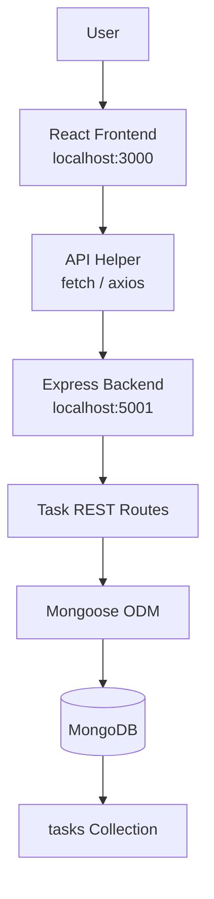

# Practical 6 — Full Stack Integration React + Node + MongoDB

## Objective
Wire the React frontend to the Node/Express/MongoDB backend into a fully functional full-stack Task Management application.

## Technology Stack
- **Frontend**: React 18, React Router DOM, Vite, CSS
- **Backend**: Node.js, Express, Mongoose, MongoDB, CORS
- **Testing**: Postman, Browser DevTools, MongoDB Compass

## Architecture


## Project Structure
```
project-root/
├── backend/
│   ├── models/
│   │   └── Task.js
│   ├── routes/
│   │   └── taskRoutes.js
│   ├── .env
│   ├── package.json
│   └── server.js
│
├── frontend/
│   ├── src/
│   │   ├── api/
│   │   │   └── api.js
│   │   ├── components/
│   │   │   ├── TaskForm.jsx
│   │   │   ├── TaskList.jsx
│   │   │   ├── TaskItem.jsx
│   │   │   ├── ConfirmDialog.jsx
│   │   │   └── Toast.jsx
│   │   ├── pages/
│   │   │   └── TaskDashboard.jsx
│   │   ├── App.jsx
│   │   ├── main.jsx
│   │   └── index.css
│   └── package.json
└── README.md
```

## Prerequisites
- Node.js installed (v18+)
- MongoDB server running on port 27017

## Backend Setup
```bash
cd backend
npm install
npm run dev
```

## Frontend Setup
```bash
cd frontend
npm install
npm run dev
```

## Environment Variables
Backend (`backend/.env`):
```env
PORT=5002
CLIENT_URL=http://localhost:3000
MONGO_URI=mongodb://127.0.0.1:27017/task_management
```

Frontend (`frontend/.env`):
```env
VITE_PORT=3000
VITE_API_URL=http://localhost:5002/tasks
```

## Running on Custom Ports
Both the frontend and backend are dynamically configured to run on custom ports:
- **Backend Port**: Configured via `PORT` in `backend/.env` (currently `5002`).
- **Frontend Port**: Configured via `VITE_PORT` in `frontend/.env` / `vite.config.js` (currently `3000`).
- **CORS & API Base URL**: CORS in Express allows `CLIENT_URL` / localhost origins, and `frontend/src/api/api.js` points dynamically to `VITE_API_URL`.

## CORS Configuration
CORS (Cross-Origin Resource Sharing) is configured in the Express backend to allow requests from the React development server (e.g. `http://localhost:3000` or custom origin specified by `CLIENT_URL`). Without this configuration, the browser's same-origin policy would block the frontend from accessing the backend APIs.

## API Endpoints
| Method | Endpoint | Purpose |
|--------|----------|---------|
| GET | /tasks | Get all tasks |
| POST | /tasks | Create task |
| GET | /tasks/:id | Get one task |
| PUT | /tasks/:id | Update task |
| DELETE | /tasks/:id | Delete task |

## React Integration
The `api.js` helper file centralizes all fetch requests to the backend (`http://localhost:5001/tasks`). It handles parsing JSON responses and throwing appropriate errors if the request fails, keeping components clean.

## CRUD Flow
- **Create**: Submits a new task via `POST`, appending the server response to the UI.
- **Read**: Fetches all tasks via `GET` on component mount.
- **Update**: Edits an existing task via `PUT`, reflecting changes immediately in the UI.
- **Delete**: Removes a task via `DELETE` after user confirmation.

## Loading States
Loading states are managed for all API operations (GET, POST, PUT, DELETE). UI elements like buttons are disabled with indicators such as "Creating..." or "Saving..." to prevent duplicate submissions and provide visual feedback.

## Error Handling
Both frontend and backend implement robust error handling. The backend returns structured JSON with success flags. The frontend safely catches errors (like network failures or validation issues) and displays user-friendly toast notifications.

## Optimistic UI
When creating a task, the UI is updated optimistically with a temporary pending task. Once the server confirms creation with the actual MongoDB `_id`, the temporary task is replaced. If the request fails, the temporary task is rolled back.

## Delete Confirmation
A custom React modal is implemented for delete confirmations to prevent accidental data loss. The user must confirm before the `DELETE` request is sent.

## Toast Notifications
A global toast notification system provides non-intrusive feedback for success and error events (e.g., "Task created successfully", "Failed to update task") without interrupting the user flow.

## MongoDB Persistence
Data is strictly persisted in MongoDB. Restarting the backend server or refreshing the browser will not result in data loss, proving proper database integration.

## Postman Testing
Test endpoints independently:
- **GET**: `http://localhost:5001/tasks`
- **POST**: `http://localhost:5001/tasks` (Body: JSON)
- **PUT**: `http://localhost:5001/tasks/:id` (Body: JSON)
- **DELETE**: `http://localhost:5001/tasks/:id`

## Browser DevTools Testing
In Chrome DevTools, open the **Network** tab to inspect XHR/Fetch requests. Verify request methods, payload bodies, HTTP status codes (200, 201, 400, 404, 500), and response structures.

---

## Key Questions / Analysis

**Q1: What changes are required on the backend (CORS) to allow the React dev server to call the Express API?**
React and Express run on different origins (Frontend: `http://localhost:3000`, Backend: `http://localhost:5001`). The browser's same-origin policy can block cross-origin requests. To resolve this, we install `cors` (`npm install cors`) and configure it in the backend:
```javascript
const cors = require('cors');
app.use(cors({ origin: 'http://localhost:3000' }));
```
This tells the browser which origins are permitted to access the backend resources.

**Q2: Why should the UI re-fetch or update local state after a successful POST/PUT/DELETE rather than assuming success silently?**
The backend is the source of truth. A successful POST generates the MongoDB `_id` and default values (like `createdAt`). A PUT may return validated or normalized data. A DELETE confirms actual resource removal. Updating state with the exact server response ensures frontend state matches server state exactly, preventing the UI from displaying stale or incorrect data.

**Q3: What is the risk of not handling errors on write operations (POST/PUT/DELETE) the same way as read operations (GET)?**
If write errors are ignored, users might believe a task was created or deleted when it actually failed. This leads to inconsistencies between the UI and MongoDB. Validation failures would be hidden, users might duplicate submissions unintentionally, and debugging becomes extremely difficult. Every API interaction mandates proper loading, success, and error handling.

## Learning Outcome
By completing Practical 6, I successfully integrated a React frontend with an Express/MongoDB backend, creating a full-stack MERN application. I gained practical experience with CORS, REST API consumption, state synchronization, optimistic UI updates, and comprehensive error handling.
