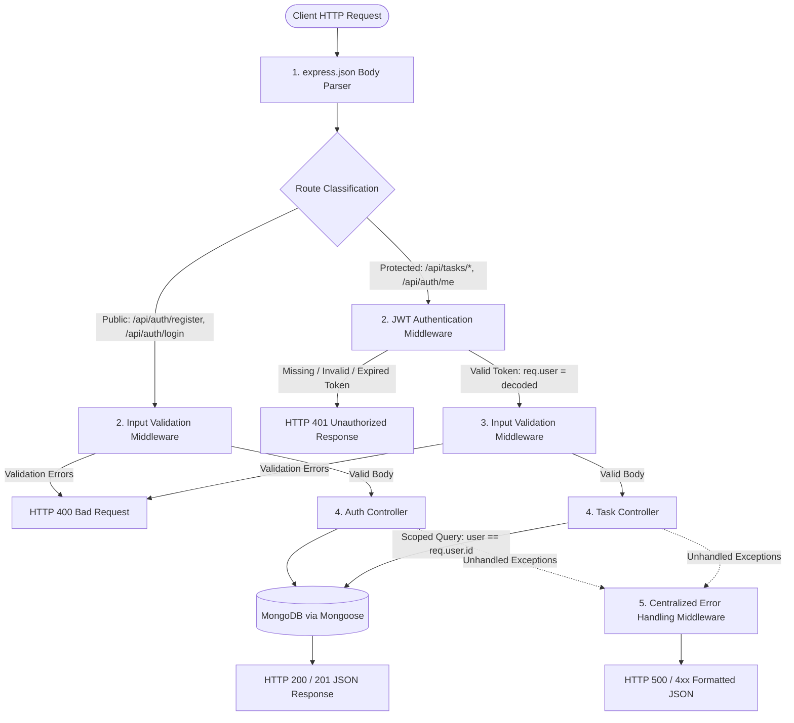

# Practical 7: Authentication and Middleware Pipeline

A production-ready Full Stack Task Management application upgraded from Practical 6, featuring JWT authentication, secure bcrypt password hashing, scoped resource ownership, server-side express-validator pipelines, and centralized error handling.

---

## 1. Objective

Implement secure user registration, login, JSON Web Token (JWT) authentication, protected task routes, server-side input validation, and a robust middleware pipeline in the Task Management full-stack application while preserving all existing CRUD functionality and data integrity.

---

## 2. Technology Stack

- **Runtime & Framework**: Node.js (v18+), Express.js (v5)
- **Database & ODM**: MongoDB, Mongoose (v9)
- **Frontend**: React 19, React Router DOM v7, Vite v8, Lucide React
- **Security & Cryptography**: `bcryptjs` (salt rounds: 10), `jsonwebtoken` (HMAC SHA-256)
- **Validation**: `express-validator` (sanitization & schema rules)
- **Config & Tooling**: `dotenv`, `cors`, Postman, Vitest / Node test runner

---

## 3. Middleware Pipeline Architecture

Every incoming request flows through a deterministic, ordered pipeline before reaching controllers and the database:



---

## 4. Project Directory Structure

```text
d:/AWDF/Pr7/
├── backend/
│   ├── config/
│   │   └── db.js                       # Mongoose connection logic
│   ├── controllers/
│   │   ├── authController.js           # register, login, getMe implementations
│   │   └── taskController.js           # User-isolated task CRUD operations
│   ├── middleware/
│   │   ├── authMiddleware.js           # JWT Bearer token verification
│   │   ├── validationMiddleware.js     # express-validator rules & validator handler
│   │   └── errorMiddleware.js          # 404 handler and centralized error middleware
│   ├── models/
│   │   ├── User.js                     # User schema (email, hashed password, createdAt)
│   │   └── Task.js                     # Task schema with user ObjectId reference
│   ├── routes/
│   │   ├── authRoutes.js               # /api/auth endpoints
│   │   └── taskRoutes.js               # /api/tasks protected endpoints
│   ├── .env                            # Environment variables (PORT, MONGO_URI, JWT_SECRET)
│   ├── .env.example                    # Template with dummy values
│   ├── .gitignore                      # Excludes node_modules and .env
│   ├── package.json                    # Backend dependencies & scripts
│   ├── server.js                       # Express app configuration & server bootstrap
│   └── test_api.js                     # Automated script verifying all 15 test cases
│
├── frontend/
│   ├── src/
│   │   ├── api/
│   │   │   └── api.js                  # Fetch wrapper attaching Bearer token & handling 401
│   │   ├── context/
│   │   │   └── AuthContext.jsx         # React context for auth state, token, login, logout
│   │   ├── components/
│   │   │   ├── Navbar.jsx              # Responsive header with user chip & logout button
│   │   │   ├── ProtectedRoute.jsx      # Route guard redirecting to /login if unauthenticated
│   │   │   ├── TaskForm.jsx            # Form component for creating & editing tasks
│   │   │   ├── TaskItem.jsx            # Individual task card
│   │   │   ├── TaskList.jsx            # Grid of task cards
│   │   │   ├── ConfirmDialog.jsx       # Modal for delete confirmation
│   │   │   └── Toast.jsx               # Feedback notifications provider & UI
│   │   ├── pages/
│   │   │   ├── Login.jsx               # Dedicated login screen with input validations
│   │   │   ├── Register.jsx            # Dedicated registration screen with password policy
│   │   │   └── TaskDashboard.jsx       # Authenticated task dashboard
│   │   ├── App.css
│   │   ├── App.jsx                     # Route definitions & application layout
│   │   ├── index.css                   # Global styles & design system tokens
│   │   └── main.jsx                    # React root entry point
│   ├── .env                            # Frontend API URL configuration
│   ├── index.html
│   ├── package.json
│   └── vite.config.js
└── README.md
```

---

## 5. Environment Configuration

### Backend `.env` (`backend/.env`)
```env
PORT=5001
MONGO_URI=mongodb://127.0.0.1:27017/task_management
JWT_SECRET=pr7_super_secret_jwt_key_98234729384729384_deepmind_2026
JWT_EXPIRES_IN=1h
CLIENT_URL=http://localhost:5173
```

### Backend `.env.example` (`backend/.env.example`)
```env
PORT=5001
MONGO_URI=mongodb://127.0.0.1:27017/task_management
JWT_SECRET=replace_with_a_long_random_secret
JWT_EXPIRES_IN=1h
CLIENT_URL=http://localhost:5173
```

### Frontend `.env` (`frontend/.env`)
```env
VITE_PORT=3000
VITE_API_URL=http://localhost:5001/api
```

---

## 6. Installation & Execution

### Prerequisites
- Node.js (v18+)
- MongoDB Community Server running locally on port 27017

### 1. Backend Setup
```bash
cd backend
npm install
npm run dev
# Server will run at http://localhost:5001
```

To run the automated suite testing all 15 test cases:
```bash
npm test
```

### 2. Frontend Setup
```bash
cd frontend
npm install
npm run dev
# Client will run at http://localhost:5173 (or configured port)
```

---

## 7. Postman & API Testing Guide (15 Test Cases)

| Test # | Objective | Method | Endpoint | Headers | Body / Notes | Expected Status |
|:---:|---|:---:|---|---|---|:---:|
| **1** | Register New User | `POST` | `/api/auth/register` | `Content-Type: application/json` | `{"email":"student@test.com","password":"Password123"}` | `201 Created` |
| **2** | Duplicate Email | `POST` | `/api/auth/register` | `Content-Type: application/json` | `{"email":"student@test.com","password":"Password123"}` | `409 Conflict` |
| **3** | Validation Failure | `POST` | `/api/auth/register` | `Content-Type: application/json` | `{"email":"invalid-email","password":"123"}` | `400 Bad Request` |
| **4** | Valid Login | `POST` | `/api/auth/login` | `Content-Type: application/json` | `{"email":"student@test.com","password":"Password123"}` | `200 OK` (Returns JWT) |
| **5** | Invalid Password | `POST` | `/api/auth/login` | `Content-Type: application/json` | `{"email":"student@test.com","password":"WrongPassword"}` | `401 Unauthorized` |
| **6** | Tasks Without Token | `GET` | `/api/tasks` | *None* | *None* | `401 Unauthorized` |
| **7** | Tasks With Invalid Token | `GET` | `/api/tasks` | `Authorization: Bearer invalid.token` | *None* | `401 Unauthorized` |
| **8** | Tasks With Expired Token | `GET` | `/api/tasks` | `Authorization: Bearer <expired-jwt>` | *None* | `401 Unauthorized` |
| **9** | Create Task (Valid) | `POST` | `/api/tasks` | `Authorization: Bearer <jwt>`, `Content-Type: application/json` | `{"title":"Practical 7 Assignment","priority":"high"}` | `201 Created` |
| **10** | Create Task (Missing Title) | `POST` | `/api/tasks` | `Authorization: Bearer <jwt>`, `Content-Type: application/json` | `{"description":"No title provided"}` | `400 Bad Request` |
| **11** | Retrieve, Update & Delete Owner Task | `GET`, `PUT`, `DELETE` | `/api/tasks/:id` | `Authorization: Bearer <jwt>` | `PUT: {"title":"Updated Title"}` | `200 OK` |
| **12** | Access Other User's Task | `GET` / `DELETE` | `/api/tasks/:otherUserId` | `Authorization: Bearer <user2_jwt>` | *Attempts accessing user 1's task* | `404 Not Found` |
| **13** | Current User (/me) | `GET` | `/api/auth/me` | `Authorization: Bearer <jwt>` | *None* | `200 OK` |
| **14** | /me Without Token | `GET` | `/api/auth/me` | *None* | *None* | `401 Unauthorized` |
| **15** | Logout Verification | UI Action | Client Side | *None* | Clears `localStorage` token, redirects to `/login` | State cleared |

---

## 8. College Viva & Practical Questions

### Q1: Why must passwords be hashed before storage?
**Answer:**
Plaintext passwords stored in a database create an immense security risk. If an unauthorized attacker gains read access to the database (via SQL/NoSQL injection, backup leaks, or compromised server access), every user account and any shared credentials across services become immediately compromised. 
Hashing using a cryptographic algorithm with adaptive work factors (such as **bcrypt**) produces an irreversible one-way digest. Bcrypt incorporates a unique random **salt** for every password to defeat rainbow table attacks, and its tunable computational cost factor slows down brute-force and dictionary attacks. The original plaintext password is never stored or recoverable.

### Q2: What does authentication middleware verify, and what happens when a token is missing or expired?
**Answer:**
The authentication middleware:
1. Inspects the incoming HTTP `Authorization` request header and validates the schema `Bearer <token>`.
2. Verifies the cryptographic digital signature of the token against the backend secret key (`process.env.JWT_SECRET`) to ensure the payload was not tampered with.
3. Checks the expiration timestamp (`exp`) embedded in the token payload.
4. Unpacks the verified user identity and assigns it to `req.user` for downstream controllers.

If the token is **missing or malformed**, the middleware short-circuits the pipeline immediately and returns `HTTP 401 Unauthorized` (`Access denied. No token provided or invalid header format.`).
If the token has **expired**, `jwt.verify()` throws a `TokenExpiredError`, which the middleware catches and responds with `HTTP 401 Unauthorized` (`Token has expired. Please log in again.`), preventing unauthorized execution of protected controllers.

### Q3: Why is server-side validation necessary even when the frontend validates input?
**Answer:**
Client-side validation is solely designed for **User Experience (UX)**—to give fast, interactive feedback in the browser. It offers **zero true security**.
Anyone can bypass frontend checks by disabling JavaScript, modifying client code via Developer Tools, or dispatching crafted HTTP requests directly using Postman, `curl`, or automated scripts.
**Server-side validation is mandatory** to maintain database integrity, enforce business constraints, prevent invalid data types, protect against injection attacks, and ensure protected fields (such as document IDs and user ownership IDs) cannot be maliciously altered by clients.

---

## 9. Supplementary Features

1. **`/api/auth/me` Endpoint**:
   Provides a stateless way for client applications upon refreshing or booting to query their identity and verify whether their stored token is still active and valid, without exposing password hashes.
2. **Graceful Token-Expiry Handling**:
   The frontend fetch helper detects `HTTP 401` responses from any protected route, purges the invalid token from `localStorage`, and emits an auth event that smoothly transitions the user back to the login screen.
3. **Scoped Ownership Isolation**:
   Tasks are filtered at the database query level (`Task.find({ user: req.user.id })`), preventing ID enumeration and cross-tenant data leakage.

---

## 10. Conclusion

Practical 7 successfully bridges full-stack application development with enterprise-grade security practices. By separating public and private routes, chaining declarative validation middleware, hashing passwords with bcrypt, issuing signed JWTs, and scoping MongoDB operations to authenticated users, the application ensures confidentiality, authorization, and data integrity.
