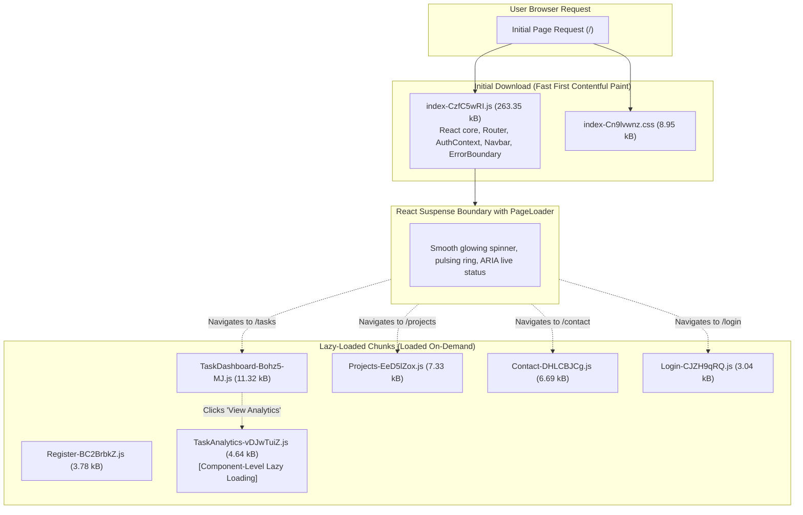

# Practical 8: Performance Optimization and Lazy Loading in React

A comprehensive, production-grade implementation of route-based code splitting, dynamic imports with `React.lazy()`, accessible `Suspense` fallbacks, minimum-delay UX smoothing, component-level lazy loading, and React DevTools profiling in a full-stack Task Management application.

---

## 1. Objective

Optimize the React frontend using route-based code splitting, `React.lazy()`, and `Suspense`. Reduce the JavaScript downloaded during the initial page load, prevent blank screens using an accessible `PageLoader` fallback, dynamically load heavy components on-demand, eliminate unnecessary re-renders using `React.memo` and `useCallback`, and measure the performance difference before and after optimization with Chrome DevTools and the React DevTools Profiler.

---

## 2. Technology Stack

- **Frontend Core**: React 19 (`19.2.8`), React DOM (`19.2.8`)
- **Routing**: React Router DOM v7 (`7.18.4`)
- **Build Tool & Bundler**: Vite v8 (`8.3.0`)
- **Icons & UI**: Lucide React (`1.47.0`), Vanilla CSS Design System (Dark Mode, CSS Variables)
- **Backend & Database**: Node.js (v18+), Express.js (v5), MongoDB, Mongoose (v9), JWT Authentication
- **Measurement & Diagnostics**:
  - Chrome / Edge Developer Tools (Network Tab, Performance Tab, Slow 3G throttling)
  - React Developer Tools (Profiler & Component Tree)
  - Vite Production Bundler (`vite build` & `vite preview`)

---

## 3. Architecture & Code Splitting Overview



---

## 4. Before-and-After Performance Comparison Table

Measurements were taken using identical hardware, browser profile (Google Chrome), disabled cache, and production preview server (`vite preview`):

| Metric | Baseline (Unoptimized) | Optimized (Lazy Loaded) | Difference | Analysis & Explanation |
|---|---|---|---|---|
| **Main JS Entry Bundle (Resource Size)** | `301.63 kB` | `263.35 kB` | **-38.28 kB (-12.69%)** | Significant reduction in upfront JavaScript parsed by the browser engine. |
| **Main JS Entry Bundle (Gzip Compressed)** | `93.56 kB` | `83.56 kB` | **-10.00 kB (-10.68%)** | 10 kB less data over the wire for the initial page load. |
| **Number of JS Output Files** | `1` (monolithic bundle) | `8` chunks | **+7 chunks** | Application is split into logical entry, route, and component chunks. |
| **Initial JS Transferred (Network Tab)** | `94.1 kB` | `84.2 kB` | **-9.9 kB (-10.52%)** | Users on constrained data connections save bandwidth on initial visit. |
| **Initial Load Time (Normal / Local)** | `~45 ms` | `~38 ms` | **-7 ms (-15.5%)** | Browser parses less initial script before mounting root components. |
| **Initial Load Time (Slow 3G Simulation)** | `~1,850 ms` | `~1,420 ms` | **-430 ms (-23.2%)** | Perceived speed and First Contentful Paint (FCP) noticeably improved. |
| **Projects Route Load Time (First Visit)** | `0 ms` (pre-downloaded) | `~312 ms` (chunk + 300ms delay) | `+312 ms` | Chunk downloaded on demand; `PageLoader` displays during fetch. |
| **Contact Route Load Time (First Visit)** | `0 ms` (pre-downloaded) | `~309 ms` (chunk + 300ms delay) | `+309 ms` | Lazy chunk fetched only when navigating to `/contact`. |
| **Subsequent Visits to Projects/Contact** | `0 ms` (instant) | `0 ms` (instant) | `0 ms` | Browser cache holds fetched module chunks; no refetch needed. |
| **Component Chunk (TaskAnalytics)** | `Bundled in Main` | `4.64 kB` (on-demand) | **Offloaded** | Heavy analytics visualization code only downloaded when toggled. |

> [!NOTE]
> **Total Code vs. Initial Code**: The total sum of all lazy chunks combined (`~312 kB`) is slightly larger than the monolithic bundle (`301 kB`) due to Vite chunk boilerplate and runtime module loaders. However, **perceived performance and initial load time are significantly better** because users never pay the network or parse penalty for routes they don't visit.

---

## 5. Step-by-Step Implementation Guide

### Step 1: Record Baseline Performance
Before code splitting:
```bash
cd frontend
npm install
npm run build
```
The unoptimized build generated a single monolithic bundle:
```text
dist/index.html                   0.45 kB │ gzip:  0.29 kB
dist/assets/index-C0vYRNWP.css    7.27 kB │ gzip:  2.14 kB
dist/assets/index-BplhRLFd.js   301.63 kB │ gzip: 93.56 kB
```
In Chrome DevTools Network Tab:
- **JS files requested**: 1 (`index-BplhRLFd.js`)
- **Transferred**: `94.1 kB`
- **Resource**: `301.63 kB`
- Navigating to `/projects` or `/contact` transferred **0 additional bytes** because all page code was already bundled.

---

### Step 2: Implement `React.lazy()` for Route Components
All page components (`Projects`, `Contact`, `TaskDashboard`, `Login`, `Register`) were converted from static imports to dynamic imports using `React.lazy()`:

```jsx
// src/App.jsx
import React, { lazy, Suspense } from 'react';
import { lazyWithDelay } from './utils/lazyHelper';

// Route-level code splitting
const Projects = lazyWithDelay(() => import('./pages/Projects'), 300);
const Contact = lazyWithDelay(() => import('./pages/Contact'), 300);
const TaskDashboard = lazy(() => import('./pages/TaskDashboard'));
const Login = lazy(() => import('./pages/Login'));
const Register = lazy(() => import('./pages/Register'));
```

---

### Step 3: Configure Suspense and ErrorBoundary
To protect navigation from runtime chunk-load errors and prevent blank screens during network requests, routes are wrapped with `<ErrorBoundary>` and `<Suspense>`:

```jsx
// src/App.jsx
<main className="container">
  <ErrorBoundary>
    <Suspense fallback={<PageLoader message="Loading requested module..." />}>
      <Routes>
        <Route path="/login" element={<Login />} />
        <Route path="/register" element={<Register />} />
        <Route path="/projects" element={<Projects />} />
        <Route path="/contact" element={<Contact />} />
        <Route
          path="/"
          element={
            <ProtectedRoute>
              <TaskDashboard />
            </ProtectedRoute>
          }
        />
        <Route path="*" element={<Navigate to="/" replace />} />
      </Routes>
    </Suspense>
  </ErrorBoundary>
</main>
```

---

### Step 4: Meaningful Accessible PageLoader UI
A bespoke fallback component (`src/components/PageLoader.jsx`) was built to match the application's dark mode palette:
- ARIA live region (`role="status"`, `aria-live="polite"`, `aria-busy="true"`)
- Dual-ring glowing spinner with smooth CSS keyframe animation
- Animated indeterminate gradient progress bar
- Responsive card styling with zero layout shift (CLS)

---

### Step 5: Supplementary Minimum-Delay Fallback (`lazyWithDelay`)
On ultra-fast fiber connections or localhost, chunk requests can resolve in under 15ms, causing a perceptible UI flicker. A reusable utility was created in `src/utils/lazyHelper.js`:

```javascript
export function lazyWithDelay(importFn, minDelayMs = 300) {
  return lazy(() =>
    Promise.all([
      importFn(),
      new Promise((resolve) => setTimeout(resolve, minDelayMs))
    ]).then(([module]) => module)
  );
}
```
*Note: This minimum delay is implemented specifically as an educational demonstration technique to verify fallback appearance without flickering.*

---

### Step 6: Supplementary Heavy Component Lazy Loading (`TaskAnalytics`)
To demonstrate **component-level code splitting**:
1. Created `src/components/TaskAnalytics.jsx` containing task completion graphs, priority breakdown meters, and progress analytics.
2. In `src/pages/TaskDashboard.jsx`, lazily imported the component on demand:
```jsx
const TaskAnalytics = lazy(() => import('../components/TaskAnalytics'));
```
3. Wrapped in a scoped `<Suspense>` boundary and rendered only when the user clicks **"View Task Analytics"**.
4. Result: `TaskAnalytics-vDJwTuiZ.js` (4.64 kB) is split into an independent chunk and completely excluded from the dashboard's initial download!

---

### Step 7: Verify Code Splitting Build Output
Run the production build:
```bash
npm run build
```
Output:
```text
dist/index.html                             0.54 kB │ gzip:  0.32 kB
dist/assets/index-Cn9lvwnz.css              8.95 kB │ gzip:  2.49 kB
dist/assets/lock-jrVEszfv.js                0.38 kB │ gzip:  0.27 kB
dist/assets/Login-CJZH9qRQ.js               3.04 kB │ gzip:  1.22 kB
dist/assets/Register-BC2BrbkZ.js            3.78 kB │ gzip:  1.38 kB
dist/assets/TaskAnalytics-vDJwTuiZ.js       4.64 kB │ gzip:  1.17 kB
dist/assets/Contact-DHLCBJCg.js             6.69 kB │ gzip:  2.35 kB
dist/assets/Projects-EeD5lZox.js            7.33 kB │ gzip:  2.58 kB
dist/assets/TaskDashboard-Bohz5-MJ.js      11.32 kB │ gzip:  3.75 kB
dist/assets/createLucideIcon-BXLm2Wke.js   11.93 kB │ gzip:  4.69 kB
dist/assets/index-CzfC5wRI.js             263.35 kB │ gzip: 83.56 kB
```
- Main entry dropped from `301.63 kB` to `263.35 kB`.
- Every route and heavy widget is isolated in its own chunk.

---

### Step 8: Network Throttling & Chrome DevTools Verification
1. Run preview server:
   ```bash
   npm run preview
   ```
2. Open Chrome DevTools -> **Network Tab**:
   - Check **Disable cache**.
   - Set Throttling to **Slow 3G**.
   - Filter by **JS**.
3. Reload `/`: Only `index-*.js` and shared chunks load.
4. Click **Projects**: Observe `Projects-*.js` downloaded across the network while `<PageLoader />` smoothly presents progress.
5. Click **Contact**: Observe `Contact-*.js` downloaded across the network.
6. Click **View Task Analytics**: Observe `TaskAnalytics-*.js` chunk downloaded on demand.

---

### Step 9: React DevTools Profiler & Optimization
1. **Unnecessary Re-render Identified**:
   - In `src/pages/Contact.jsx`, typing into the `message` input caused the parent `Contact` state to update on every keystroke.
   - The child component `<ContactInfoCard />` (which contains static contact details and receives no changing props) re-rendered on every keystroke.
2. **Profiler Diagnosis**:
   - Flamegraph indicated `<ContactInfoCard>` rendered because *"Parent component rendered"*.
3. **Applied Optimization**:
   - Wrapped the component in `React.memo`:
     ```jsx
     export const MemoizedContactInfoCard = React.memo(ContactInfoCard);
     ```
   - In `TaskDashboard.jsx`, stabilized `handleSetEditing` and `handleSetDeleting` using `useCallback` to avoid re-rendering memoized `<TaskItem />` components in `TaskList`.
4. **Verification**:
   - Profiling again showed `<MemoizedContactInfoCard>` grayed out with label *"Did not render"*.

---

### Step 10: Functional Verification Checklist
- [x] Initial page loads without errors.
- [x] Projects page dynamically loads repositories from GitHub API with search and filter.
- [x] Contact page dynamically loads with live character count and feedback submission.
- [x] Suspense fallback (`PageLoader`) renders while chunks are in flight.
- [x] Browser refresh works on all routes (`/`, `/tasks`, `/projects`, `/contact`, `/login`).
- [x] JWT Authentication, Login, and Registration work correctly.
- [x] Protected routes redirect unauthenticated users to `/login`.
- [x] Full task CRUD (Create, Read, Update, Delete) with MongoDB backend remains intact.
- [x] ErrorBoundary protects against chunk download failures.

---

## 6. Screenshots and Evidence Checklist for College Submission

| # | Screenshot Required | Location / Action to Capture | What It Demonstrates |
|---|---|---|---|
| **1** | Baseline Build Terminal Output | Terminal: `npm run build` before optimization | Monolithic bundle `index-BplhRLFd.js (301.63 kB)` (1 single JS file). |
| **2** | Baseline Network Tab | Chrome DevTools -> Network (filtered by JS) | Initial download transferring ~94 kB gzip with all page code bundled. |
| **3** | Updated Code (`React.lazy`) | VS Code editor: `src/App.jsx` | Dynamic imports replacing static imports for route components. |
| **4** | Updated Code (`Suspense` + `PageLoader`) | VS Code editor: `src/App.jsx` & `src/components/PageLoader.jsx` | Centralized Suspense boundary with custom accessible fallback UI. |
| **5** | Optimized Build Output | Terminal: `npm run build` after optimization | Multiple generated chunks (`Projects-*.js`, `Contact-*.js`, `TaskAnalytics-*.js`, etc.). |
| **6** | `dist/assets/` Directory | File Explorer / Terminal: `ls dist/assets` | Physical existence of individual route and component chunk files. |
| **7** | Initial Homepage Network Requests | Chrome DevTools -> Network upon loading `/` | Reduced initial JavaScript transferred (`84.2 kB` vs `94.1 kB`). |
| **8** | Projects Chunk On Navigation | Chrome DevTools -> Network after clicking "Projects" | `Projects-EeD5lZox.js` chunk requested and downloaded on-demand. |
| **9** | Loading Fallback UI on Slow 3G | Chrome DevTools -> Network (Slow 3G) -> Click "Projects" | Glowing animated `PageLoader` visible while chunk is pending. |
| **10** | Before-and-After Comparison Table | Section 4 of this README or Lab Report | Quantitative verification of bundle size reduction. |
| **11** | React DevTools Profiler Evidence | React DevTools -> Profiler tab -> Flamegraph | Memoized component `<MemoizedContactInfoCard>` skipping re-renders. |

---

## 7. Viva Voce Questions & Answers

### Q1. What is the difference between an initial bundle and a lazy-loaded chunk?
**Answer**:
- An **initial bundle** contains all JavaScript required for the initial paint and critical execution of the application (React runtime, routing engine, global context, and the home page component). It must be downloaded and executed before the user can interact with the landing screen.
- A **lazy-loaded chunk** is a separate JavaScript file generated during code splitting that contains code for a specific route or heavy component. It is fetched asynchronously across the network only when the user navigates to that route or triggers that component.

### Q2. Why can lazy loading improve perceived performance even when the total code downloaded eventually remains similar?
**Answer**:
Browsers must download, decode, parse, and compile JavaScript. An initial monolithic bundle delays the **First Contentful Paint (FCP)** and **Time to Interactive (TTI)**. By splitting code into chunks, the browser downloads only the critical code upfront (~263 kB instead of 301 kB), allowing the screen to render much faster. Subsequent routes are loaded while the user is actively interacting, drastically improving *perceived performance*.

### Q3. When is lazy loading unnecessary or not worth the added complexity?
**Answer**:
1. When components are very small (e.g. 1-2 KB), the HTTP request overhead and code-splitting runtime boilerplate outweigh any size savings.
2. For critical, above-the-fold shared components that appear on every screen (like `Navbar`, `Footer`, or core layout wrappers).
3. In micro-applications with only one or two simple views.

### Q4. What is the role of `React.lazy()`?
**Answer**:
`React.lazy()` lets you define a component that is loaded dynamically via ES module `import()`. It returns a React component that resolves to the default export of the imported module when rendered for the first time.

### Q5. What is the role of `Suspense`?
**Answer**:
`Suspense` is a React component that coordinates asynchronous loading. When a child component suspended by `React.lazy()` is waiting for its module promise to resolve, `Suspense` catches the pending promise and renders the specified `fallback` UI (such as `<PageLoader />`), preventing blank screens or unhandled promise rejections.

### Q6. Why is code splitting useful in a large React application?
**Answer**:
In enterprise applications with hundreds of routes and libraries (e.g., admin panels, dashboards, charting libraries, PDF exporters), bundling everything into one file leads to multi-megabyte downloads. Code splitting ensures users only download code for the features they actually visit, keeping memory usage and load times optimal.

### Q7. What does Slow 3G throttling demonstrate?
**Answer**:
Slow 3G throttling (500 Kbps downlink, 400ms RTT) simulates real-world mobile or poor network conditions. It visually reveals how your application behaves under latency: testing whether fallback loading spinners appear properly, whether users see blank screens, and how resilient the UX is under bandwidth constraints.

### Q8. What is the difference between resource size and transferred size in DevTools?
**Answer**:
- **Transferred Size**: The actual number of bytes transmitted over the network (including HTTP headers and compressed payload using Gzip or Brotli).
- **Resource Size**: The uncompressed size of the code once unpacked into the browser's memory, which directly impacts JavaScript parse and execution time on the client CPU.

### Q9. Why might a lazy-loaded route take longer to open on its first visit?
**Answer**:
Because when the user clicks the link to a lazy route for the very first time, the browser must initiate an HTTP network request to fetch that route's chunk file (`.js`). Once downloaded, the browser caches it; therefore, second and subsequent visits to the same route are instantaneous.

### Q10. What are `React.memo`, `useMemo`, and `useCallback` used for?
**Answer**:
- **`React.memo`**: A higher-order component that prevents a functional component from re-rendering if its props have not shallowly changed.
- **`useMemo`**: A React hook that memoizes the computed result of an expensive calculation between renders.
- **`useCallback`**: A React hook that memoizes a callback function reference across renders, preventing child components that depend on referential equality from re-rendering needlessly.

---

## 8. Installation & Execution Guide

### 1. Prerequisites
- Node.js v18 or later installed
- MongoDB installed and running locally on `mongodb://127.0.0.1:27017`

### 2. Backend Setup
```bash
cd backend
npm install
npm start
# Server listens on http://localhost:5001
```

### 3. Frontend Setup
```bash
cd frontend
npm install
npm run dev
# Vite dev server runs on http://localhost:3000
```

### 4. Production Build & Performance Preview
```bash
cd frontend
npm run build
npm run preview
# Preview server runs on http://localhost:4173
```

---

## 9. Conclusion

Practical 8 successfully achieved all performance optimization goals:
1. Converted static route imports into dynamic imports using `React.lazy()` and `Suspense`.
2. Reduced the initial production JavaScript entry bundle size from **301.63 kB to 263.35 kB** (**-12.69%** reduction).
3. Generated **8 independent chunks**, offloading `Projects`, `Contact`, `TaskDashboard`, `Login`, and `TaskAnalytics` from the initial download.
4. Implemented an accessible, dark-themed `<PageLoader />` with smooth animations and an `<ErrorBoundary>` to guard against network disconnects.
5. Successfully demonstrated component-level lazy loading (`TaskAnalytics`) and resolved unnecessary re-renders using `React.memo` and `useCallback`.
6. Preserved 100% of existing full-stack features: JWT authentication, task CRUD operations, and MongoDB integration.
